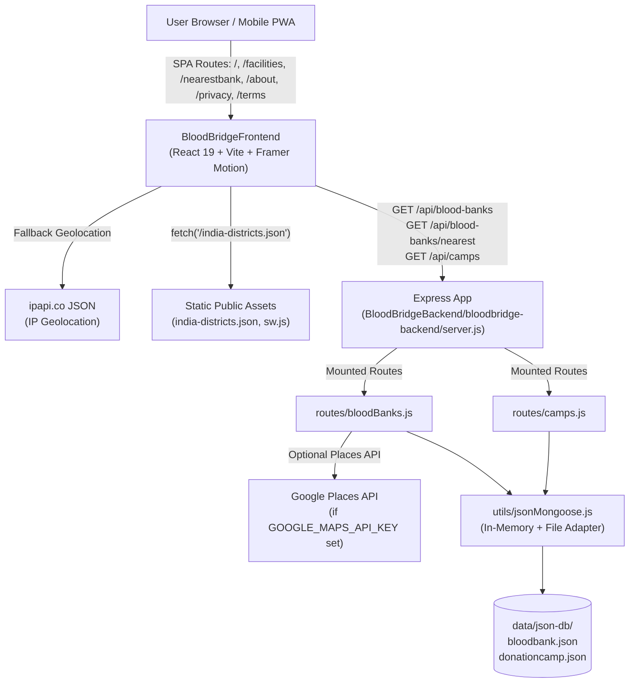

<div align="center" id="top">

<!-- Animated Typing Hero Header -->
<a href="https://github.com/godlyinsane/BloodBridge">
  
</a>

<br />

<!-- Dynamic Tech Stack & Status Badges -->
<p>
  
  
  
  = 20" />
  
  
  
  
  
</p>

<!-- Interactive Navigation Bar -->
<p>
  <a href="#about">About</a> •
  <a href="#features">Features</a> •
  <a href="#architecture">Architecture</a> •
  <a href="#quickstart">Quickstart</a> •
  <a href="#configuration">Configuration</a> •
  <a href="#deep-dives">Deep Dives</a> •
  <a href="#roadmap">Roadmap</a>
</p>

</div>

<!-- Subtle Wave Divider -->


---

> [!TIP]
> **Demo Showcase:** Drop a screen recording (`.gif` or `.mp4`) of BloodBridge in action below to preview the GPS locator, Facilities directory, and Dark/Light theme switcher directly on GitHub.
>
> <div align="center">
>   <!-- Replace the src below with your recorded demo, e.g. ./assets/bloodbridge-demo.gif -->
>   
>   <br />
>   <sub><em>Replace with <code>&lt;img src="./path/to/demo.gif" width="800" /&gt;</code> or drag-and-drop an <code>.mp4</code> into GitHub.</em></sub>
> </div>

---

## <a id="about"></a>🩸 About BloodBridge

During medical emergencies, families often lose critical time searching fragmented directories and making dead-end calls to locate compatible blood facilities. **BloodBridge** solves this with a zero-friction, public discovery platform that maps verified blood banks, hospital centres, and community distribution drives with one-tap calling and turn-by-turn Google Maps navigation. Developed as an **Engineering Projects in Community Service (EPICS)** initiative at **VIT Bhopal University**, it runs effortlessly on everything from low-end mobile phones to desktop browsers—with zero login walls, zero tracking, and an out-of-the-box local JSON database engine.

---

## <a id="features"></a>✨ Feature Matrix

| Emoji | Feature | Technical Implementation |
| :---: | :--- | :--- |
| 🚨 | **Critical Dispatch Emergency Bar** | Persistent top bar (`EmergencyBanner.jsx`) with one-tap `tel:108`, `tel:102`, and quick jump to the nearest blood bank view. |
| 📍 | **Live GPS Nearest Bank Locator** | Browser Geolocation + IP geolocation fallback (`ipapi.co`) paired with Haversine distance sorting and optional Google Places enrichment (`/api/blood-banks/nearest`). |
| 🏥 | **Verified Facilities & Drives Directory** | Searchable directory (`CampsAndBanksView`) filtering 32+ hospitals, government/Red Cross centres, and distribution drives by district, category, and service type. |
| 🧬 | **Clinical Blood Group Reference** | Interactive 8-group (`O+` to `AB-`) compatibility matrix detailing Indian prevalence, clinical roles, and donor/recipient matching rules. |
| 🌓 | **Theme & Smooth Motion System** | Instant dark/light theme persistence (`localStorage`), Framer Motion spring-gliding tab pills (`layoutId`), and hover elevation/border cues. |
| 📱 | **Cross-Device & PWA Ready** | Touch-optimized responsive rules (`index.css`), iOS input zoom prevention, safe-area insets, and offline-resilient service worker (`public/sw.js`). |
| 🗄️ | **Zero-Config Local JSON Storage** | Lightweight `jsonMongoose.js` adapter backed directly by `data/json-db/*.json`—zero external database setup required. |

---

## <a id="architecture"></a>🏗️ Visual System Architecture



---

## <a id="quickstart"></a>🚀 Copy-Paste Quickstart

### Prerequisites
- **Node.js** `>= 20` and **npm**

### 1. Clone & Install Dependencies

```bash
git clone https://github.com/godlyinsane/BloodBridge.git
cd BloodBridge

# Install root, frontend, and backend dependencies
npm install
npm --prefix BloodBridgeFrontend install
npm --prefix BloodBridgeBackend/bloodbridge-backend install
```

### 2. Configure Environment (Optional)

```bash
# Copy the backend template (works out of the box with local JSON storage)
cp BloodBridgeBackend/bloodbridge-backend/.env.example BloodBridgeBackend/bloodbridge-backend/.env
```

### 3. Run in Development Mode

```bash
# Terminal 1 — Start Express API (http://localhost:5000)
npm --prefix BloodBridgeBackend/bloodbridge-backend run dev

# Terminal 2 — Start Vite Dev Server (http://localhost:5173)
npm --prefix BloodBridgeFrontend run dev
```

### 4. Build & Run in Production Mode

```bash
# Build frontend static bundle into BloodBridgeFrontend/dist
npm run build

# Start backend server
npm start

# Preview built frontend locally
npm --prefix BloodBridgeFrontend run preview
```

### 5. Run Tests

```bash
# Frontend unit/component tests (Vitest + Testing Library)
npm --prefix BloodBridgeFrontend test

# Backend tests (Node built-in test runner)
npm --prefix BloodBridgeBackend/bloodbridge-backend test

# End-to-end mobile tests (Playwright)
npm --prefix BloodBridgeFrontend run test:e2e
```

---

## <a id="configuration"></a>⚙️ Environment Configuration

| Variable | Scope | Default | Description |
| :--- | :--- | :--- | :--- |
| `PORT` | Backend | `5000` | Port the Express server listens on. |
| `CLIENT_ORIGIN` | Backend | `http://localhost:5173` | Comma-separated list of allowed CORS origins. |
| `GOOGLE_MAPS_API_KEY` | Backend | *(unset)* | Optional Google Places API key to augment `/api/blood-banks/nearest` with live Places results. |
| `VITE_GOOGLE_MAPS_API_KEY` | Backend / Frontend | *(unset)* | Optional fallback key checked by `routes/bloodBanks.js` for Google Places queries. |
| `VITE_API_BASE_URL` | Frontend | `http://localhost:5000/api` (dev) / `/api` (prod) | Overrides the backend API base URL at build time. |

---

## <a id="deep-dives"></a>🔍 Technical Deep Dives

<details>
<summary><b>📁 Full Annotated Repository Structure</b></summary>

```text
BloodBridge/
├── BloodBridgeBackend/
│   └── bloodbridge-backend/
│       ├── data/
│       │   ├── indiaDistrictCentres.json   # Regional district coordinate reference
│       │   └── json-db/
│       │       ├── bloodbank.json          # Local JSON store for blood bank listings
│       │       └── donationcamp.json       # Local JSON store for donation camps
│       ├── models/
│       │   ├── BloodBank.js                # Mongoose schema for blood bank facilities
│       │   └── DonationCamp.js             # Mongoose schema for donation drives
│       ├── routes/
│       │   ├── bloodBanks.js               # Directory listing & Haversine/Places nearest-bank search
│       │   └── camps.js                    # Public donation camp listing endpoint
│       ├── test/
│       │   └── bloodListingsAndNearestBanks.test.js
│       ├── utils/
│       │   └── jsonMongoose.js             # Lightweight Mongoose-compatible JSON file engine
│       ├── .env.example                    # Environment variable template
│       ├── package.json
│       ├── seed.js                         # Database seed script
│       └── server.js                       # Express entrypoint, CORS, health checks, DB switcher
├── BloodBridgeFrontend/
│   ├── e2e/
│   │   └── mobile.spec.js                  # Playwright mobile responsiveness tests
│   ├── public/
│   │   ├── bloodbridge-logo.svg
│   │   ├── india-districts.json            # Indian states & districts lookup dataset
│   │   ├── manifest.json                   # PWA web manifest
│   │   └── sw.js                           # Service worker for cached shell support
│   ├── src/
│   │   ├── App.jsx                         # Main router, Home, Facilities, About, Privacy & Terms views
│   │   ├── App.test.jsx                    # Vitest suite covering routing, theme toggle & legal pages
│   │   ├── EmergencyBanner.jsx             # Critical dispatch top bar (108 / 102 / Nearest bank)
│   │   ├── NearestBloodBankMap.jsx         # GPS + manual search nearest blood bank finder
│   │   ├── index.css                       # Design tokens, hover states, touch & mobile breakpoints
│   │   └── index.jsx                       # React 19 root mount
│   ├── package.json
│   ├── playwright.config.js
│   └── vite.config.js
├── package.json                            # Root build & start scripts
```

</details>

<details>
<summary><b>🌐 Backend API Reference</b></summary>

| Method | Endpoint | Query Params | Description |
| :--- | :--- | :--- | :--- |
| `GET` | `/` | — | Returns backend liveness JSON (`{ status }`). |
| `GET` | `/api/health` | — | Liveness check reporting `status`, `database` (`local-json` or Mongoose state), and `runtime`. |
| `GET` | `/api/health/ready` | — | Readiness check after database initialization. |
| `GET` | `/api/blood-banks` | `district`, `city`, `category` | Lists all blood banks sorted alphabetically by name with optional case-insensitive filters. |
| `GET` | `/api/blood-banks/nearest` | `lat`, `lng`, `query`, `radius` (5–200 km, default 50) | Calculates Haversine distances from GPS coordinates (or matches text query) across `BloodBank` records and optional Google Places results, returning up to 30 sorted centres. |
| `GET` | `/api/camps` | — | Lists all blood donation camps sorted ascending by `date`. |

</details>

<details>
<summary><b>🛠️ Troubleshooting & Common Issues</b></summary>

- **No external database setup needed:** `server.js` loads `utils/jsonMongoose.js` and serves all records directly from `data/json-db/` (`bloodbank.json` and `donationcamp.json`).
- **Frontend API calls fail in local dev:** Ensure the backend is running on port `5000` (`http://localhost:5000/api`) or set `VITE_API_BASE_URL` in `BloodBridgeFrontend/.env`.
- **Geolocation blocked or denied on desktop/mobile:** `NearestBloodBankMap.jsx` automatically falls back to `https://ipapi.co/json/` and also provides a manual city/district/PIN search bar.
- **CORS error on custom port/domain:** Add your frontend origin to `CLIENT_ORIGIN` in `BloodBridgeBackend/bloodbridge-backend/.env` (comma-separated, no trailing slash).

</details>

---

## <a id="roadmap"></a>🗺️ Roadmap

- [x] Verified hospital & blood bank directory with district, category, and service filters (`/facilities`)
- [x] GPS-assisted nearest blood bank locator with Haversine ranking & Google Maps directions (`/nearestbank`)
- [x] Zero-config local JSON database engine (`jsonMongoose.js`)
- [x] Responsive mobile/tablet layout, dark/light theme switcher, and PWA shell
- [x] Unit, component, and mobile E2E test suites (`Vitest` + `Node test` + `Playwright`)
- [ ] Live blood component stock indicators synced with participating blood banks
- [ ] Multi-language regional UI support (Hindi & English)

---

## 🤝 Contributing & Team

Contributions are welcome!

1. Fork the repository
2. Create a feature branch (`git checkout -b feat/your-feature`)
3. Commit your changes (`git commit -m "feat: describe your change"`)
4. Push to your branch (`git push origin feat/your-feature`)
5. Open a Pull Request

**EPICS Project · VIT Bhopal University:**
- **Priyansh Bhatt** — Lead Developer & Researcher
- **Varun Kumar** — Presentation & Pitch Lead
- **Deeptanshu** — Overall Review & QA
- **Krishna Thakkar** — Project Report & Documentation
- **Abhijit Chauhan** — Preliminary Testing & Feedback
- **Jayesh Joshi** — Bug Hunting & Testing

<div align="center">
  <br />
  <a href="#top">⬆ Back to Top</a>
</div>
